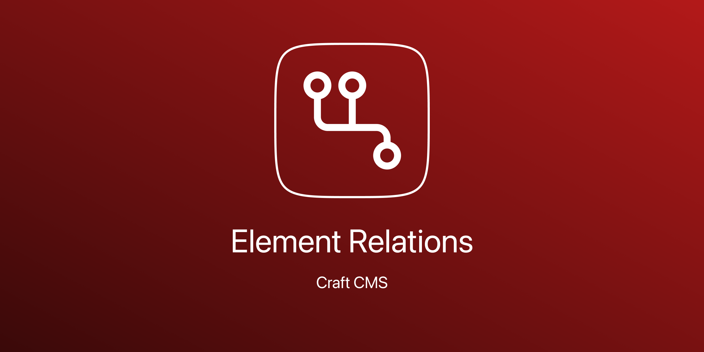
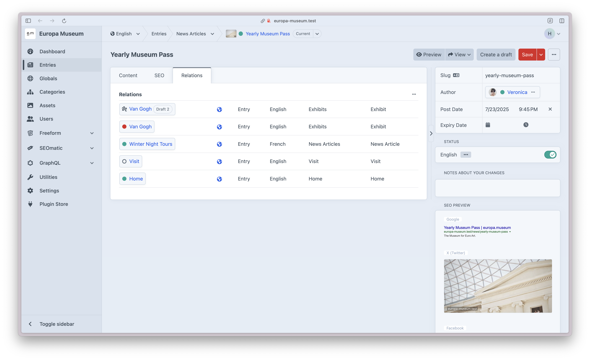
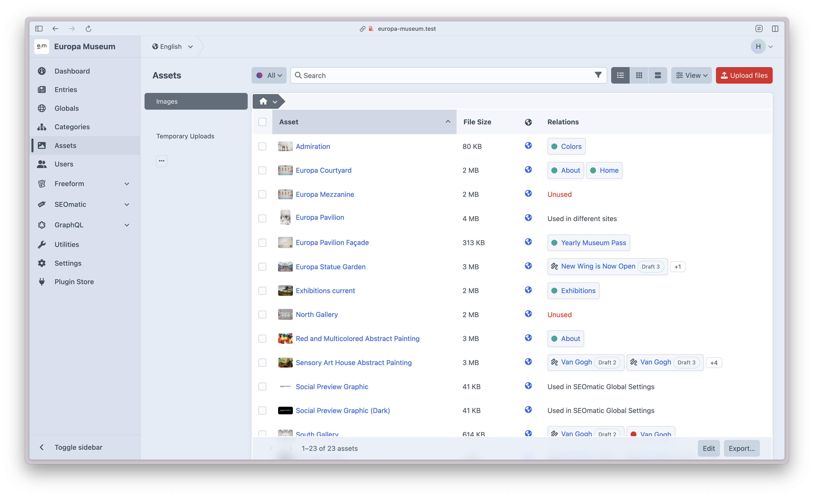
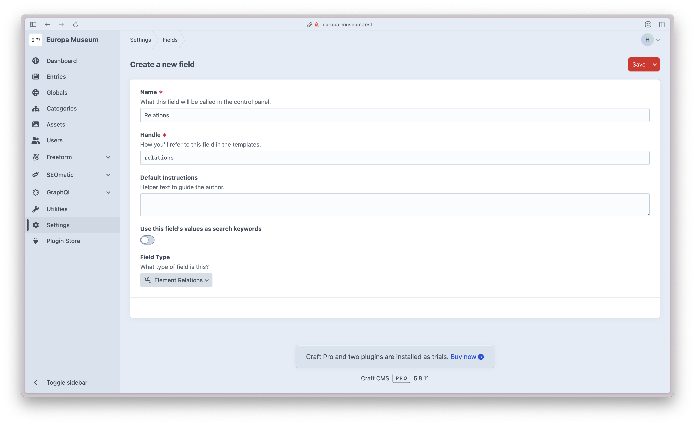
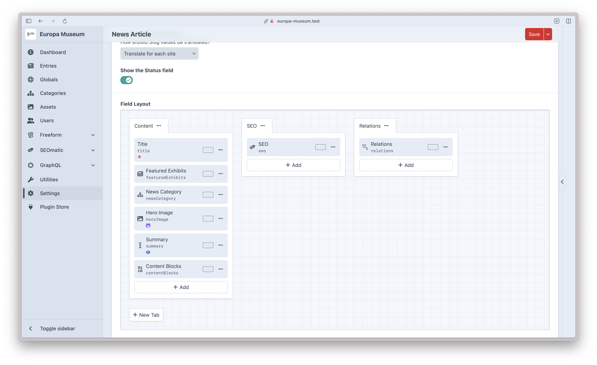

# Element Relations Plugin for Craft CMS 5

This plugin shows all relations of an element. For example, where an asset, entry or any other element is linked.

__Feature Requests are welcome!__




## Requirements

This plugin requires Craft CMS 5.3 or later. Use the 3.1.x releases for Craft 4.


## Installation
To install this plugin, follow these steps:
1. Install with Composer via `composer require internetztube/craft-element-relations`
2. Install plugin in the Craft Control Panel under Settings > Plugins

You can also install this plugin via the Plugin Store in the Craft Control Panel.

## Support
As a basis the relations table is used. This means that any field that stores relations in the relations table will work out of the box.

* Entries, Assets, Categories, Globals, Users, Products, ... 
* Matrix
* Content Block, Addresses (Craft 5 core nested fields)
* Neo
* SuperTable
* User Photo
* SEOmatic
* Redactor
* CkEditor
* Hyper
* LinkIt
* TypedLinkField
* Link (Craft 5 core field)
* Vizy
* Navigation (nodes linking an element, shown as their menu)
* Wishlist (list items, shown as their list)
* Formie (form redirect entries, element field defaults, notification attachments, submission field values)
* FreeLink
* SEO (by Ether)
* LinkMate  
... and many more.

## Usage

### Field settings

The field is Craft's element index, so its settings are the ones you know from Craft's relational fields: View Mode (table or cards; authors can switch it in the View menu, which also offers more table columns), Show the status menu and Elements per page. On multi-site installs the list covers every site at once, with a Site column.

### GraphQL
The Element Relations field exposes its data in GraphQL. Query the field by its handle to
access counts, usage flags, and related elements. Below is a minimal example fetching usage
information for a field named `relationsField` on an entry:

```graphql
{
  entry(slug: "my-entry") {
    ... on entry_default_Entry {
      title
      relationsField {
        count
        isInUse
        elements(limit: 2) {
          id
          title
        }
        
        globalCount: count(siteIds: []),
        globalIsInUse: isInUse(siteIds: []),
        globalElements: elements(
            siteIds: [],
            limit: 2,
            sections: ['sectionHandle'],
            entryTypes: ['entryTypeHandle'],
            status: ['live']
        ) {
          id
          title
        }
      }
    }
  }
}
```

### Twig
Obtain a `RelationsModel` instance from any element’s relations field, then use its methods to inspect usage.
```twig
{# Fetch the RelationsModel from a field named `relationsField` #}

{# @var relationsModel \internetztube\elementRelations\models\RelationsModel #}

```

#### Is in use?
```twig
{# Check if the element is used in the current site #}

    {# ... #}


{# Check usage across all sites #}

    {# ... #}


{# Check usage in specific sections/entry types #}

    {# ... #}


{# Only count live elements (default: every status, including disabled) #}

    {# ... #}

```

#### Elements
```twig
{# All related elements in elements site #}


{# All related elements across all sites #}


{# Filter by specific site id(s) #}


{# Limit number of results (e.g., first 2 items) #}


{# Filter by sections and entry types #}


{# Combine filters with limit #}


{# All options #}

```

#### Elements Iterator
```twig

    {{ dump(element) }}


{# Filter by sections/entry types while iterating #}

    {{ element.title }}

```

#### Sites
```twig
{# List of sites where the element is in use #}

```

#### Element queries
```twig
{# Any element query can be filtered by what it uses #}

```
Across all element types at once (entries, products, menus, ... returned as their real classes), in PHP:
```php
use internetztube\elementRelations\elements\Usage;

$everything = Usage::find()->usesElement($asset)->search('contact')->all();
```

#### Non-element usages
```twig
{# Plugin settings that reference the element, e.g. SEOmatic's global or per-section SEO image #}

    <a href="{{ usage.url }}">{{ usage.label }}</a>

```


## Screenshots

Asset Overview


---

Asset detail


---

Create Field


---

Add to Field Layout


## Development
`dev/dev.sh` spins up a throwaway Craft 5 project (PostgreSQL via Homebrew) with the plugin symlinked in, seeds test content and starts a server at http://localhost:8080/admin (admin / password).

```sh
dev/dev.sh                      # setup + serve (PostgreSQL)
DB_DRIVER=mysql dev/dev.sh      # same on MySQL (own project dir via PROJECT_DIR=...)
dev/dev.sh smoke                # seed, rebuild cache, run dev/smoke.php (180 assertions)
vendor/bin/phpstan              # static analysis
```

GitHub Actions (`.github/workflows/ci.yml`) runs PHPStan and the same `dev/dev.sh ci` smoke test on PHP 8.2 and 8.3 against MySQL 8 and PostgreSQL 14, with every supported plugin installed.

### Editions

Lite is everything above. Pro (behind a feature flag for now: `'features' => ['editions' => true]` in `config/element-relations.php`) adds:

- **Unused:** a “Used anywhere” rule in Craft’s index filter and custom-source conditions, an “Unused” source on the asset, category and tag indexes (with Craft’s bulk actions), and `craft.assets().unused()`. Sorting an index by the field (relation count) works in Lite.
- **Replace:** on the element itself, the field's “Replace…” button guides you through picking the replacement and ticking the usages to replace. In an element index, “Replace everywhere…” does all of them at once. Relational fields, nested entries, CKEditor/Redactor reference tags and SEOmatic images are rewritten through Craft’s save path; anything else is listed for a manual change.

## Issues
Please report any issues you find to the [Issues](https://github.com/internetztube/craft-element-relations/issues) page.


Brought to you by [Frederic Koeberl](https://frederickoeberl.com/)
