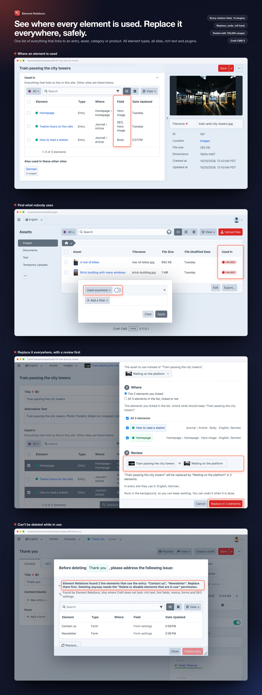

# Element Relations for Craft CMS 5

**See where every element is used. Replace it everywhere, safely.**

One list of everything that links to an entry, asset, category, product or any other element. It covers all element types, all sites, rich text and the plugins you use. The list is Craft's own element index, so it looks and works like the rest of the control panel.



[Tour with screenshots](docs/README.md) · [Installation](#installation) · [Twig, GraphQL and element queries](#usage) · [Supported fields and plugins](#supported-fields-and-plugins)

## Why

Every Craft project asks the same questions. Can I delete this asset? Which pages show this category? Where is the old logo still used? Craft's relations table knows part of the answer. It knows nothing about CKEditor links, link fields from plugins, SEOmatic images, Navigation menus, Formie forms or Vizy blocks. Element Relations answers all of it in one place, and lets you act on the answer.

## What you get

- **One list for every element type.** Entries, Matrix and other nested content, assets, categories, tags, users, products, global sets, Navigation menus, Formie forms. The list shows the site you are editing; each row shows where the element lives and which field holds the link. An element used through two fields is one row and counts once. Other sites that use their version are listed below, so nothing used elsewhere looks unused.
- **Everything that can link.** Anything in Craft's relations table works out of the box. Rich text, link fields and plugins that store links elsewhere are read by their own extractors. 13 plugins today, see [Supported fields and plugins](#supported-fields-and-plugins).
- **Plugin settings count too.** Usages that are not elements, like SEOmatic's global SEO image, are listed below the field.
- **Native.** Craft's search, sorting, status and drafts filter, table or card view, the columns of the View menu, and Craft's own filter rules and sort options (Section, Post Date, Author, Filename, Group, …). Plus an “Element Type” filter rule, and a dropdown for element type with counts when the list mixes types. The list shows what uses the element in the site you are editing; the other sites whose version is used are listed below it, with a link each. An index column shows the first usages and the total, and you can sort by it.
- **Follows permissions.** Users only see usages they may view. A line says how many are hidden, so nobody takes an element for unused.
- **In code too.** `isInUse`, counts and the related elements in Twig and GraphQL. `usesElement` on any element query.
- **Built for scale.** Relations are read on save and stored in one indexed table. Saves that change no custom field skip the work. Lists and counts are paged SQL queries. The load test uses one asset in 100,000 entries ([`dev/stress.php`](dev/stress.php)); its list opens in under a second.
- **Find what nobody uses.** A “Usage” rule in Craft's filter: used live, used in any status, not used live (only drafts or disabled, pending or expired entries use it), or unused. It works on any source, with Craft's bulk actions. In code: `craft.assets().usage('none')`.
- **Replace anywhere.** Swap one element for another, everywhere or only in the usages you tick. From the field, or from the command line (also with a CSV file, for migrations). Every supported field and plugin is rewritten the same way it was read.
- **Undo, roll back, revisions.** Undo in the notice. A history with Roll back under Utilities. Entries get a revision with a note. Revert to revisions.
- **Keep what is in use.** Editors can't delete or take offline what live content uses. Craft's delete dialog lists the usages, with “Replace…” right there.
- **Never blocks the page.** Replacements and rollbacks run as queue jobs in batches, as the user who started them. They resume if a worker dies.

## Tested

Three test suites run on every push, on PHP 8.2 and 8.3, on MySQL 8 and PostgreSQL 14: a console test, the control panel over HTTP, and the control panel in headless Chrome. Over 1,400 checks. Every supported plugin is seeded and round-tripped (read, replace, roll back). 100 % line coverage of `src/`. [`dev/TESTS.md`](dev/TESTS.md) lists every check in one sentence.

## Requirements

Craft CMS 5.3 or later, PHP 8.2 or later. For Craft 4, use the 3.1.x releases.

## Installation

Install from the Plugin Store in the control panel, or with Composer:

```sh
composer require internetztube/craft-element-relations
php craft plugin/install element-relations
```

Then create an **Element Relations** field and add it to the field layouts of the elements you want to inspect (assets, entries, categories, …). After the install, the plugin builds its cache for existing content in the queue.

## Configuration

Copy [`src/config.php`](src/config.php) to `config/element-relations.php` to set the plugin settings per environment:

| Setting | Default | Description |
|---|---|---|
| `bulkRefreshBatchSize` | `2000` | Elements one queue job handles per batch when the whole cache is rebuilt. |
| `rebuildParallelJobs` | `1` | Queue jobs a full rebuild runs at the same time (see [Queue](#queue)). At most your number of queue workers. |
| `protectInUse` | `true` | Elements that live content uses can't be deleted or taken offline (see [Protection](#protect-what-is-in-use)). |

Field settings (per field): View mode (table or cards; authors can switch it in the View menu), Show the status menu, Default Status (the status the list starts with, e.g. only live elements), Elements per page, Elements in index columns (default 5).

You can rebuild the cache any time under Utilities → Element Relations, or with `php craft element-relations/resave-relations`. `php craft element-relations/prune` removes rows of elements that no longer exist; garbage collection does that by itself.

### Queue

The cache works like Craft's search index: kept up to date as you work, rebuilt in full only as a repair.

- **When something is saved,** one small queue job refreshes just the saved elements, at the end of the request. It runs ahead of Craft's default jobs (priority 1022). Deleting an element removes its rows right away.
- **A full rebuild** (plugin install, the utility, `resave-relations`) splits all elements into `rebuildParallelJobs` parts of about the same size and queues one job per part. Each job refreshes `bulkRefreshBatchSize` elements, then queues itself again for the rest of its part. So the queue holds at most `rebuildParallelJobs` rebuild jobs (“Rebuild Element Relations (part 2 of 4)”, each with its progress), and other jobs get in between. Releasing a part's job in the queue screen stops that part; a part whose worker died starts again where it was.
- **More than one queue worker is fine.** The parts never share elements, and every job only rewrites the rows of the elements it handles. A save that races a rebuild for the same element can leave duplicate rows for a moment; counts and lists ignore them, and the element's next refresh replaces them. Garbage collection's cleanup only deletes rows that nothing can read, so two of them at once are harmless. Replacements and rollbacks run one batch at a time, whatever the number of workers.
- **Choosing `rebuildParallelJobs`:** the default 1 rebuilds in one part, one batch after another, and never takes more than one worker. With several workers you can raise it: set it to at most their number, minus a few to keep workers free for editors' jobs while a rebuild runs (for example 4 to 8 with 16 workers). More parts finish sooner, but load the database more.

Elements Craft no longer shows, like the Neo blocks a field converted to Matrix leaves behind, are left out of a rebuild altogether.

## Supported fields and plugins

Anything that stores its targets in Craft's relations table works out of the box:

- Entries, Assets, Categories, Tags, Users, Products and other relation fields, also inside Matrix, Neo, Super Table, Content Block and Addresses
- Craft's Link field and plugin fields that implement `RelationalFieldInterface`
- User photos

Own extractors (each one can also rewrite what it reads, for replace):

| Plugin | What is read |
|---|---|
| CKEditor, Redactor | reference tags in links and images |
| SEOmatic | SEO, Twitter and Open Graph images in the field, global and per-section settings |
| Hyper, LinkIt, Typed Link Field, LinkMate, FreeLink | element links |
| Vizy | link marks, images, fields inside blocks |
| SEO (by Ether) | social images |
| Navigation | nodes that link to an element (listed as their menu) |
| Wishlist | list items (listed as their list) |
| Formie | redirect entries and rules, element field defaults, notification attachments, submission values |

Missing one? [Open an issue](https://github.com/internetztube/craft-element-relations/issues), or register your own extractor (see [Events](#events)).

## Usage

### Twig

Get the `RelationsModel` from the element's field:

```twig
{# @var relationsModel \internetztube\elementRelations\models\RelationsModel #}


…                     {# in the element's site #}
…                 {# in any site #}
…   {# only live elements count #}
…


…


{# plugin settings that use the element, e.g. SEOmatic's global SEO image #}

    <a href="{{ usage.url }}">{{ usage.label }}</a>

```

A full example site that uses all of this (destination pages that list their stories, backlinks, author pages): [`dev/templates`](dev/templates).

For elements with thousands of usages, use `count` or `isInUse` (one SQL query each), give `elements` a limit, or loop with `elementsIterator` (batches). `elements` without a limit loads every related element.

`siteIds`: leave it out for the element's site, `[]` for all sites. With `[]`, an element used in two sites counts once, and `elements` returns it once (in the first site it is used in). `status` and `drafts`: leave them out for what visitors may see on the front end (live entries, enabled elements, no drafts). In the control panel and on the console, the default is every status, drafts included. `status: null, drafts: null` means everything, everywhere.

Statuses depend on the element type: `live` for entries and products, `enabled` for categories and assets, `active` for users. A list may mix them; each type takes the words it knows: `status: ['live', 'enabled']`. `sections` and `entryTypes` return entries only. For anything else, use Craft's own queries with `usesElement`: `craft.products().type('clothing').usesElement(entry)`, `craft.assets().volume('photos').usesElement(entry).orderBy('title')`. Any element type, any of Craft's params.

### Element queries

```twig

      {# also: unused() #}
         {# also: unused(false) #}
         {# used by live entries, enabled elements or plugin settings #}
   {# only drafts, disabled, pending or expired elements use them #}
```

“Live” is what visitors see: no drafts, enabled in the site, and for entries and Commerce products posted and not expired. Plugin settings count as live.

All element types at once (entries, products, menus, …, each as its real class), with any of Craft's query params:

```twig


```

```php
use internetztube\elementRelations\elements\Usage;

$everything = Usage::find()->usesElement($asset)->search('contact')->all();
```

### GraphQL

The relations field returns only what the schema may read. Elements of sections, volumes, groups and sites outside the schema are left out. Element types without a GraphQL scope (Formie, Navigation, Wishlist, other plugin elements) are never returned. Without `status`, entries must be live and other elements enabled. `status` needs the “Query for non-enabled elements” scope.

Craft's own queries take a `usesElement` argument. So any query with any of Craft's arguments works, with Craft's scoping and status defaults: `entries(section: "news", usesElement: 12) { title }`, `products(type: "clothing", usesElement: 12) { id }`, `assets(usesElement: [12, 13]) { url }`, `entryCount(usesElement: 12)`. `status: null` means every status. This works up to 50,000 usages; above that, use the relations field's `count` and `elements` with a limit.

```graphql
{
  entry(slug: "my-entry") {
    ... on page_Entry {
      relationsField {
        count
        isInUse
        elements(limit: 2) { id title }
        anywhere: count(siteIds: [])
        liveNews: elements(siteIds: [], sections: ["news"], status: ["live"]) { id title }
      }
    }
  }
}
```

## Unused, replace and protection

In detail:

- **Usage filter:** a “Usage” rule in Craft's index filter: Used live, Used (any status), Not used live, Unused. It works on any source, with Craft's bulk actions, and in custom sources (make one for a fixed “Not used live” or “Unused” entry in the sidebar). In code: the `usage()` query param. Plugin settings (SEOmatic) count as a usage. Rules saved with the earlier “Used anywhere” switch keep working.
- **Live column:** next to the field's own column, every element index offers “<field> (live)” in its View menu, so each author picks what they want to see: all usages, only the live ones, or both. It shows the live usages and “Not used live” when only drafts or disabled, pending or expired entries use the element, and you can sort by it.
- **Replace:** tick usages in the field's list and choose “Replace…”, or choose “Replace everywhere…” in an element index. A slideout opens: pick the replacement, untick usages or take all in the filtered list (across pages), and read a summary before anything changes. On a multi-site install it asks for the sites too: only the one you are editing (the default) or all of them. Its review shows how many elements change in each site. Content that is the same in several sites (a field that isn't translated per site, on an entry or a Matrix block that exists in more than one site) can't change in one site alone; the review names those elements and the other sites they change in. Plugin settings are listed for a manual change. Only elements the user may save are touched.
- **Undo and rollback:** the success notice has an Undo button. Utilities → Element Relations lists every replacement with Roll back. Rolling back swaps the link back and keeps later edits. Entries get a revision with a note for each step.
- **Background:** replacements and rollbacks from the control panel run as queue jobs, in batches, as the user who started them. So saving many or large entries never blocks the page. The notice shows the progress and offers Undo when the job is done. If a job gets lost (a worker stopped), it resumes where it was: by itself while the notice waits, with Resume in the history, or on the command line.
- **Command line:** `php craft element-relations/replace` for scripts and migrations, see [Command line](#command-line).
- <a id="protect-what-is-in-use"></a>**Protect what is in use:** in the control panel, an element that live content uses (live entries, enabled elements, plugin settings) can't be deleted, disabled, disabled for a site, expired or scheduled. The error names the usages the user may view and counts the rest. On Craft 5.10 and later, Craft's delete dialog lists them first, with “Replace…” and, only with the permission, “Delete anyway”. This covers the edit page, slideouts and the index actions Delete, Set status and Delete for site. Drafts and disabled elements that point to it don't count. Users with the permission “Delete or disable elements that are in use” (admins) may go ahead. Console commands, migrations, queue jobs and settings changes (like deleting a section) are never blocked.

### Permissions

What a user sees in the field follows Craft's permissions (`Elements::canView()`). Elements they may not view are left out of the list, search, sorting, counts and exports. A line below the list says how many usages are hidden, so nobody takes an element for unused.

Three permissions:

| Permission | Allows |
|---|---|
| Replace element references | “Replace…” in the field and “Replace everywhere…” |
| Roll back replacements | Undo, Roll back and Revert to revisions, for their own replacements |
| Delete or disable elements that are in use | Deleting, disabling, expiring or scheduling elements that live content uses |

Admins have all of them. They can roll back anyone's replacements and see everyone's in the history; other users see their own. Replacing also needs the right to view both elements, to save every element that changes, and to edit the field (the field layout's “Who can edit” rule). Everything else is skipped and not named. A queued replacement runs as the user who started it. It does not run if that user is gone or lost the permission.

### Revisions

Entries changed by a replacement or rollback get a revision with a note. This includes entries whose Matrix (or other nested) content changed. Element types without revisions (assets, categories, global sets, plugin elements) and entries in sections with versioning off get none; the wizard, the success message and the history say how many. The history offers two ways back:

- **Roll back:** swaps the link back to the original. Changes made since are kept.
- **Revert to revisions:** puts the changed entries back to their revision from before the replacement, with Craft's own revision revert. Changes made since are lost. Elements without revisions are swapped back.

## Command line

Replacements from the command line run right away (no queue), without a user. They land in the history like any other, so you can roll them back:

```sh
php craft element-relations/replace 12 34                  # replace element #12 with #34 everywhere
php craft element-relations/replace 12 34 --usages=56,78   # only in these related elements (ids as listed in the field)
php craft element-relations/replace 12 34 --dry-run        # list what would change, change nothing
php craft element-relations/replace 12 34 --site=de        # elements of another site (handle or id)
php craft element-relations/replace/map duplicates.csv     # many at once: one "from,to" pair of ids per line
php craft element-relations/replace/history --limit=50     # the latest replacements with their ids
php craft element-relations/replace/rollback 1234          # roll one back (--revisions: revert entries to their revisions)
php craft element-relations/replace/resume 1234            # continue one whose queue job got lost (e.g. a worker stopped)
```

A mapping file may have a header line and `#` comments. For example, after merging duplicate assets:

```csv
from,to
# old asset, kept asset
412,388
415,388
```

In a content migration, call the service:

```php
use craft\elements\Asset;
use internetztube\elementRelations\services\ReplaceService;

public function safeUp(): bool
{
    $result = ReplaceService::replace(Asset::find()->id(412)->one(), Asset::find()->id(388)->one());
    echo "Replaced in {$result['replaced']} elements (rollback: #{$result['operationId']})\n";
    return true;
}
```

`ReplaceService::replace($from, $to, $onlySourceIds)` returns `replaced`, `skipped` (usages that need a manual change), `operationId` and `withoutRevision`. `onlySiteId: 3` limits it to the usages in one site; `ReplaceService::sharedWithOtherSites($from, 3)` tells beforehand which of them change in other sites as well. `ReplaceService::rollback()` undoes an operation.

## Events

Register your own extractors, or react to replacements:

```php
use craft\events\RegisterComponentTypesEvent;
use internetztube\elementRelations\events\ReplaceEvent;
use internetztube\elementRelations\services\ExtractorService;
use internetztube\elementRelations\services\ReplaceService;
use yii\base\Event;

// a field extractor implements InterfaceFieldExtractor (and InterfaceFieldReplacer for replace);
// the first extractor that returns records for a field wins, so put specific ones first
Event::on(ExtractorService::class, ExtractorService::EVENT_REGISTER_FIELD_EXTRACTORS, function (RegisterComponentTypesEvent $event) {
    array_unshift($event->types, MyFieldExtractor::class);
});

// element extractors (InterfaceElementExtractor / InterfaceElementReplacer) and non-element usage providers
// (RelationsModel::EVENT_REGISTER_GLOBAL_USAGE_PROVIDERS, InterfaceGlobalUsage) work the same way

Event::on(ReplaceService::class, ReplaceService::EVENT_BEFORE_REPLACE, function (ReplaceEvent $event) {
    // $event->from, $event->to, $event->sourceIds; set $event->isValid = false to stop it
});
Event::on(ReplaceService::class, ReplaceService::EVENT_AFTER_REPLACE, function (ReplaceEvent $event) {
    // $event->result['replaced'], $event->result['skipped'], $event->operation
});
// ReplaceService::EVENT_AFTER_ROLLBACK: $event->result['restored'], $event->operation
```

## Logging

Extractor errors, replacements and rollbacks go to `storage/logs/element-relations-<date>.log`. In dev mode, extractor errors are thrown instead.

## Screenshots

Every feature, shown in the demo site: [docs/README.md](docs/README.md).

## Development

`dev/dev.sh` creates a throwaway Craft 5 project with every supported plugin and a second site. It seeds test content and starts a server at http://localhost:8080/admin (admin / password). Next to the test content (section “Pages”), the seed builds a demo site for the screenshots ([`dev/demo.php`](dev/demo.php)): “Transit”, a travel journal with articles, a team, company pages, a homepage made of content blocks, menus, forms, drafts and German translations. The photos are the author's own ([Frederic Köberl on Unsplash](https://unsplash.com/@internetztube)). They are downloaded on the first seed; without network, drawn placeholders are used.

```sh
dev/dev.sh                      # setup + serve (PostgreSQL)
DB_DRIVER=mysql PROJECT_DIR=../craft-element-relations-dev-mysql PORT=8081 dev/dev.sh
dev/dev.sh smoke                # seed and run dev/smoke.php (every integration, incl. replace and rollback)
dev/dev.sh e2e                  # control panel over HTTP: every usage through Replace…, undo, history
dev/dev.sh screenshots          # retake docs/screenshots from the demo site (headless Chrome)
vendor/bin/phpstan              # static analysis
```

GitHub Actions runs PHPStan, the smoke test and the control panel tests on PHP 8.2 and 8.3, on MySQL 8 and PostgreSQL 14.

## Support

Please report issues and feature requests on [GitHub](https://github.com/internetztube/craft-element-relations/issues).

Brought to you by [Frederic Koeberl](https://frederickoeberl.com/)
