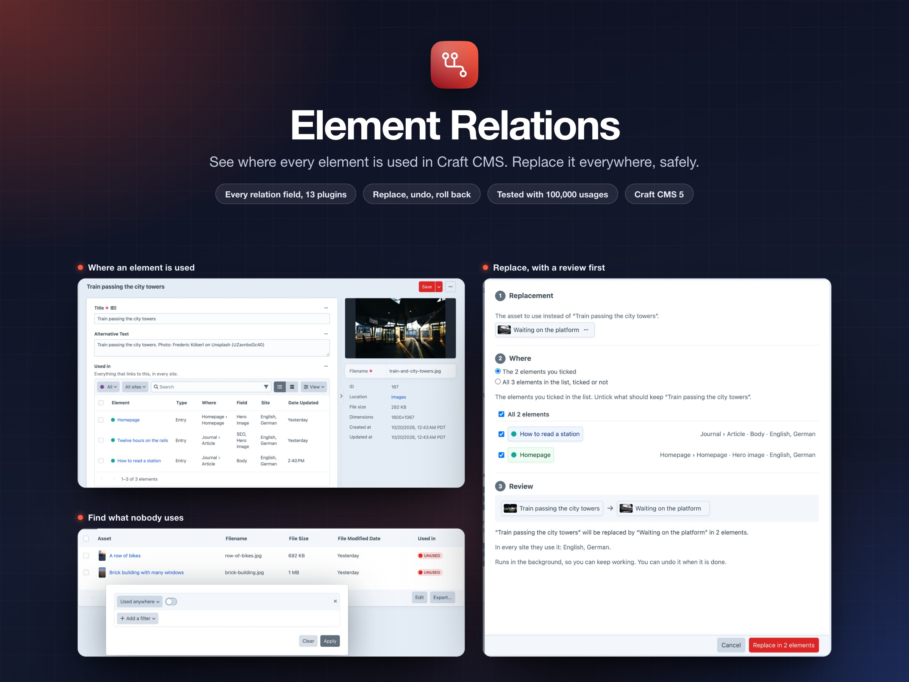

# Element Relations for Craft CMS

See where every element is used. One native list of everything that links to an entry, asset, category, product or any other element, across all element types, sites and the plugins your project uses.



More in the [tour](docs/README.md).

## Features

- **One list, every element type.** The field is Craft's own element index: search, sort, status and Drafts filter, table or card view, chips that link to the edit pages. Type and site dropdowns with counts, plus columns for where the element lives, the field that holds the link (and whether it sits in a disabled Matrix block) and the site.
- **Everything that can link to an element.** Anything Craft stores in its relations table works out of the box. Rich text, link fields and plugins that store references elsewhere are read by dedicated extractors (see [Supported fields and plugins](#supported-fields-and-plugins)).
- **Plugin settings, too.** Usages that are not elements, such as SEOmatic's global or per-section SEO image, are listed below the field.
- **Templates, GraphQL and element queries.** `isInUse`, counts and the relating elements in Twig and GraphQL; `usesElement` on any element query.
- **Fast, also at scale.** Relations are extracted when an element is saved and cached in one indexed table; saves that change no custom field skip the work. Lists, counts and the index column stay paginated and SQL-based for elements with tens of thousands of usages; replacements and rollbacks run in batches.

**Pro** (behind a feature flag for now, see [Editions](#editions)):

- **Unused:** a “Used anywhere” rule in Craft's index filter (on top of any source, with the bulk actions) and in custom sources, `craft.assets().unused()`.
- **Replace:** swap an element for another everywhere or in the usages you pick, in a slideout right from the field, or from the command line (also with a CSV mapping, for migrations). Every supported field and plugin is rewritten the way it was read, in the background.
- **Undo and rollback:** Undo right in the notice, a history with Roll back in Utilities, revisions with notes for entries.

## Requirements

Craft CMS 5.3 or later, PHP 8.2 or later. Use the 3.1.x releases for Craft 4.

## Installation

Install from the Plugin Store in the control panel, or with Composer:

```sh
composer require internetztube/craft-element-relations
php craft plugin/install element-relations
```

Then create an **Element Relations** field and add it to the field layouts of the elements you want to inspect (assets, entries, categories, …). Installing the plugin builds the relations cache for existing content in the queue.

## Configuration

Copy [`src/config.php`](src/config.php) to `config/element-relations.php` to override the plugin settings per environment:

| Setting | Default | Description |
|---|---|---|
| `bulkRefreshBatchSize` | `2000` | Elements per queue job when the whole relations cache is rebuilt. |
| `features.editions` | `false` | Offer the Lite and Pro editions. |

Field settings (per field): View Mode (table or cards; authors can switch it, the View menu offers more columns), Show the status menu, Elements per page.

The cache can be rebuilt any time under Utilities → Element Relations or with `php craft element-relations/resave-relations`.

## Supported fields and plugins

Anything that stores its targets in Craft's relations table works out of the box, including:

- Entries, Assets, Categories, Tags, Users, Products and other relation fields, also inside Matrix, Neo, Super Table, Content Block and Addresses
- Craft's Link field and plugin fields implementing `RelationalFieldInterface`
- User photos

Dedicated extractors (each one can also rewrite what it reads, for Pro's replace):

| Plugin | What is read |
|---|---|
| CKEditor, Redactor | reference tags in links and images |
| SEOmatic | SEO, Twitter and Open Graph images in the field, global and per-section settings |
| Hyper, LinkIt, Typed Link Field, LinkMate, FreeLink | element links |
| Vizy | link marks, images, fields inside blocks |
| SEO (by Ether) | social images |
| Navigation | nodes linking an element (listed as their menu) |
| Wishlist | list items (listed as their list) |
| Formie | redirect entries and rules, element field defaults, notification attachments, submission values |

Missing one? [Open an issue](https://github.com/internetztube/craft-element-relations/issues), or register your own extractor (see [Events](#events)).

## Usage

### Twig

Get the `RelationsModel` from the element's field:

```twig
{# @var relationsModel \internetztube\elementRelations\models\RelationsModel #}


…                     {# in the element's site #}
…                 {# in any site #}
…   {# only live elements count #}
…


…


{# plugin settings that reference the element, e.g. SEOmatic's global SEO image #}

    <a href="{{ usage.url }}">{{ usage.label }}</a>

```

For elements with thousands of usages use `count`/`isInUse` (one SQL query each), pass a `limit` to `elements`, or walk them with `elementsIterator` (batches); `elements` without a limit loads every relating element.

`siteIds`: omitted = the element's site, `[]` = all sites. `status` and `drafts`: omitted = what visitors may see on the front end (live entries, enabled elements, no drafts), every status and drafts in the control panel and console; `status: null, drafts: null` for everything.

### Element queries

```twig

   {# Pro #}
```

Across all element types at once (entries, products, menus, … returned as their real classes):

```php
use internetztube\elementRelations\elements\Usage;

$everything = Usage::find()->usesElement($asset)->search('contact')->all();
```

### GraphQL

The relations field only returns what the GraphQL schema may read: elements of sections, volumes, groups and sites outside the schema are left out, and element types without a GraphQL scope (Formie, Navigation, Wishlist, other plugin elements) are never returned. Without `status`, entries must be live and other elements enabled; `status` needs the “Query for non-enabled elements” scope.

```graphql
{
  entry(slug: "my-entry") {
    ... on page_Entry {
      relationsField {
        count
        isInUse
        elements(limit: 2) { id title }
        anywhere: count(siteIds: [])
        liveNews: elements(siteIds: [], sections: ["news"], status: ["live"]) { id title }
      }
    }
  }
}
```

## Editions

The plugin is a single Lite edition today; everything in [Features](#features) except the Pro list is Lite. The Pro edition is ready behind a feature flag (`'features' => ['editions' => true]` in `config/element-relations.php`) and adds:

- **Unused:** “Used anywhere” rule in Craft's index filter (on top of any source, with Craft's bulk actions) and in custom-source conditions; create a custom source with it for a fixed “Unused” entry in the sidebar. `unused()` element query param. Non-element usages (SEOmatic settings) count as used.
- **Replace:** tick usages in the field's list and choose “Replace…” (or “Replace everywhere…” in an element index); a slideout picks the replacement, lets you untick usages or take all in the filtered list, across pages, and shows a summary before anything changes. Plugin settings are listed for a manual change. Only elements the user may save are touched.
- **Undo and rollback:** the success notice has an Undo button; Utilities → Element Relations lists every replacement with Roll back. Rolling back swaps the reference back and keeps later edits. Entries get a revision with a note for each step.
- **Background:** replacements and rollbacks from the control panel run as queue jobs, in batches, as the user who started them, so saving many or large entries never blocks the page. The notice shows the progress and offers Undo when it is done. A job that got lost (a worker stopped) is resumed where it got: automatically while the notice waits, with Resume in the history, or on the command line.
- **Command line:** `php craft element-relations/replace` for scripts and migrations, see [Command line](#command-line-pro).

### Permissions

What a control panel user sees in the field follows Craft's permissions (`Elements::canView()`): elements they may not view are left out of the list, its search, sorting, counts and exports. A line below the list says how many usages are hidden, so nobody takes an element for unused.

Pro adds two permissions:

| Permission | Allows |
|---|---|
| Replace element references | “Replace…” in the field and “Replace everywhere…” |
| Roll back replacements | Undo, Roll back and Revert to revisions, for their own replacements |

Admins have both, can roll back anyone's replacements and see everyone's in the history; other users see their own. Replacing also needs permission to view both elements, to save every element that gets changed and to edit the field (a field layout's “Who can edit” condition); everything else is skipped and not named. A queued replacement runs as the user who started it and is not run when they are gone or lost the permission.

### Revisions (Pro)

Entries changed by a replacement or rollback get a revision with a note, including entries whose Matrix (or other nested) content changed. Element types without revisions (assets, categories, global sets, plugin elements) and entries in sections with versioning off get none; the wizard, the success message and the history say how many. The history offers two ways back:

- **Roll back:** swaps the replacement back for the original; changes made since are kept.
- **Revert to revisions:** reverts the changed entries to their revision from before the replacement with Craft's revision revert (changes since are discarded); elements without revisions are swapped back.

## Command line (Pro)

Replacements from the command line run right away (no queue), without a user, and land in the history like any other, so they can be rolled back:

```sh
php craft element-relations/replace 12 34                  # replace element #12 with #34 everywhere
php craft element-relations/replace 12 34 --usages=56,78   # only in these relating elements (ids as listed in the field)
php craft element-relations/replace 12 34 --dry-run        # list what would change, change nothing
php craft element-relations/replace 12 34 --site=de        # elements of another site (handle or id)
php craft element-relations/replace/map duplicates.csv     # many at once: one "from,to" pair of ids per line
php craft element-relations/replace/history --limit=50     # the latest replacements with their ids
php craft element-relations/replace/rollback 1234          # roll one back (--revisions: revert entries to their revisions)
php craft element-relations/replace/resume 1234            # continue one whose queue job got lost (e.g. a worker stopped)
```

A mapping file may have a header line and `#` comments, e.g. after merging duplicate assets:

```csv
from,to
# old asset, kept asset
412,388
415,388
```

In a content migration, call the service directly:

```php
use craft\elements\Asset;
use internetztube\elementRelations\services\ReplaceService;

public function safeUp(): bool
{
    $result = ReplaceService::replace(Asset::find()->id(412)->one(), Asset::find()->id(388)->one());
    echo "Replaced in {$result['replaced']} elements (rollback: #{$result['operationId']})\n";
    return true;
}
```

`ReplaceService::replace($from, $to, $onlySourceIds)` returns `replaced`, `skipped` (usages that need a manual change), `operationId` and `withoutRevision`; `ReplaceService::rollback()` undoes an operation.

## Events

Register your own extractors, or react to replacements:

```php
use craft\events\RegisterComponentTypesEvent;
use internetztube\elementRelations\events\ReplaceEvent;
use internetztube\elementRelations\services\ExtractorService;
use internetztube\elementRelations\services\ReplaceService;
use yii\base\Event;

// a field extractor implements InterfaceFieldExtractor (and InterfaceFieldReplacer to support replace);
// the first extractor that returns records for a field wins, so put specific ones first
Event::on(ExtractorService::class, ExtractorService::EVENT_REGISTER_FIELD_EXTRACTORS, function (RegisterComponentTypesEvent $event) {
    array_unshift($event->types, MyFieldExtractor::class);
});

// element extractors (InterfaceElementExtractor / InterfaceElementReplacer) and non-element usage providers
// (RelationsModel::EVENT_REGISTER_GLOBAL_USAGE_PROVIDERS, InterfaceGlobalUsage) work the same way

Event::on(ReplaceService::class, ReplaceService::EVENT_BEFORE_REPLACE, function (ReplaceEvent $event) {
    // $event->from, $event->to, $event->sourceIds; set $event->isValid = false to stop it
});
Event::on(ReplaceService::class, ReplaceService::EVENT_AFTER_REPLACE, function (ReplaceEvent $event) {
    // $event->result['replaced'], $event->result['skipped'], $event->operation
});
// ReplaceService::EVENT_AFTER_ROLLBACK: $event->result['restored'], $event->operation
```

## Logging

Extractor errors, replacements and rollbacks are logged to `storage/logs/element-relations-<date>.log`. In dev mode extractor errors are thrown instead.

## Screenshots

Every feature, in the demo site: [docs/README.md](docs/README.md).

## Development

`dev/dev.sh` spins up a throwaway Craft 5 project with every supported plugin and a second site, seeds test content and starts a server at http://localhost:8080/admin (admin / password). Next to the test fixtures (section “Pages”) the seed builds a demo site for screenshots ([`dev/demo.php`](dev/demo.php)): “Transit”, a travel journal with articles, team, company pages, a homepage of content blocks, menus, forms, drafts and German translations, with photos by Frederic Köberl on [Unsplash](https://unsplash.com/@internetztube) (downloaded on the first seed; drawn pictures without network).

```sh
dev/dev.sh                      # setup + serve (PostgreSQL)
DB_DRIVER=mysql PROJECT_DIR=../craft-element-relations-dev-mysql PORT=8081 dev/dev.sh
dev/dev.sh smoke                # seed and run dev/smoke.php (every integration, incl. replace and rollback)
dev/dev.sh e2e                  # control panel over HTTP: every usage through Replace…, undo, history
dev/dev.sh screenshots          # retake docs/screenshots from the demo site (headless Chrome)
vendor/bin/phpstan              # static analysis
```

GitHub Actions runs PHPStan, the smoke test and the control-panel test on PHP 8.2 and 8.3 against MySQL 8 and PostgreSQL 14.

## Support

Please report issues and feature requests on [GitHub](https://github.com/internetztube/craft-element-relations/issues).

Brought to you by [Frederic Koeberl](https://frederickoeberl.com/)
