# Element Relations: a tour

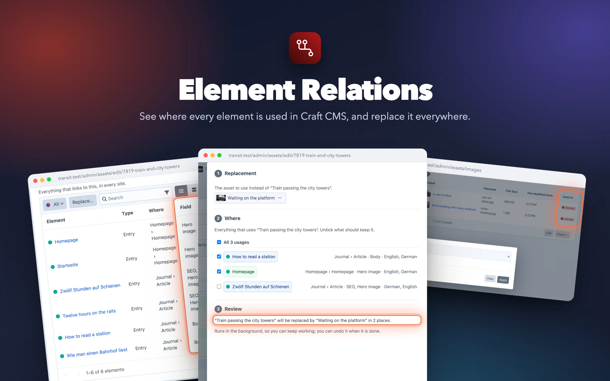

Screenshots of the plugin in the demo site “Transit”, a fictional travel journal (photos by Frederic Köberl on [Unsplash](https://unsplash.com/@internetztube)). The demo is part of the dev environment: `dev/dev.sh` builds it, `dev/dev.sh screenshots` retakes every picture on this page.

## See where every element is used

The **Element Relations** field lists everything that links to the element it sits on: entries, Matrix and other nested content, products, Navigation menus, Formie forms, global sets, users, in every site. Each row says where it lives, through which field, and in which site.

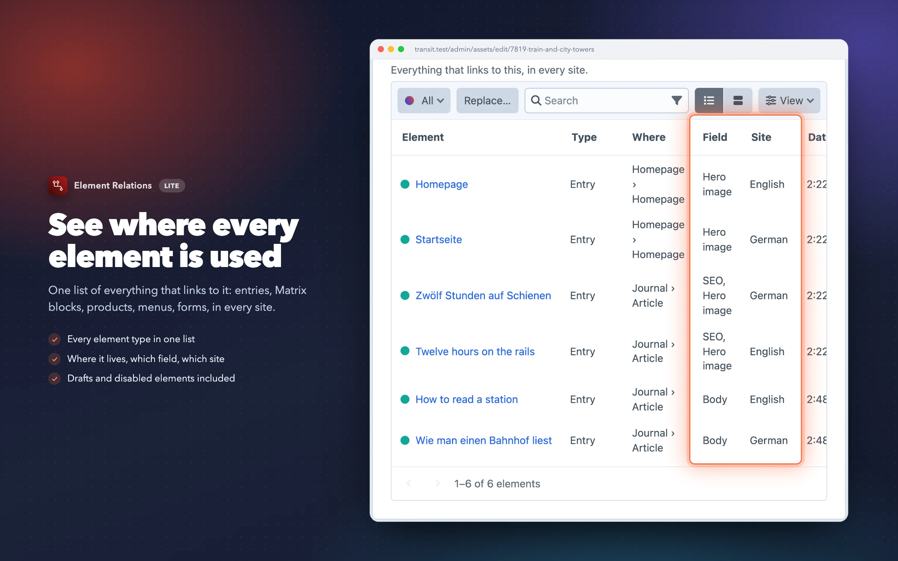

## Filter by element type

When an element is used by several element types, a dropdown with counts per type joins Craft's own search, sorting, status menu and pagination.

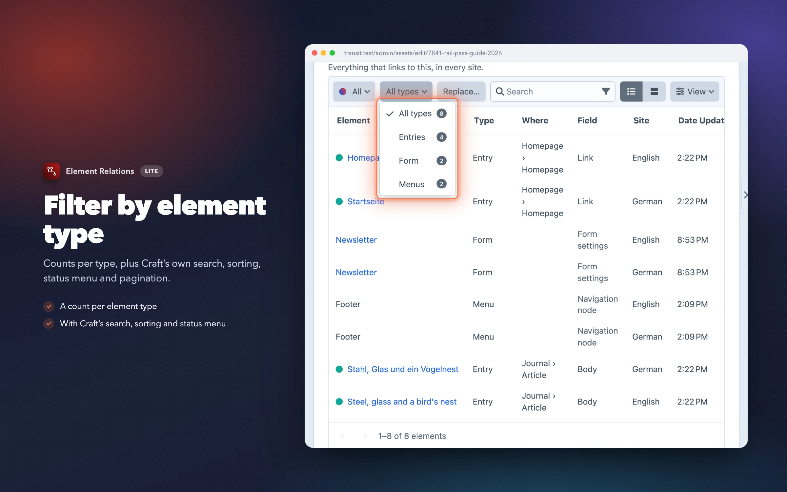

## Table or cards

The field renders Craft's native element index, so it looks and works like the rest of the control panel, including card view and the View menu's extra columns.

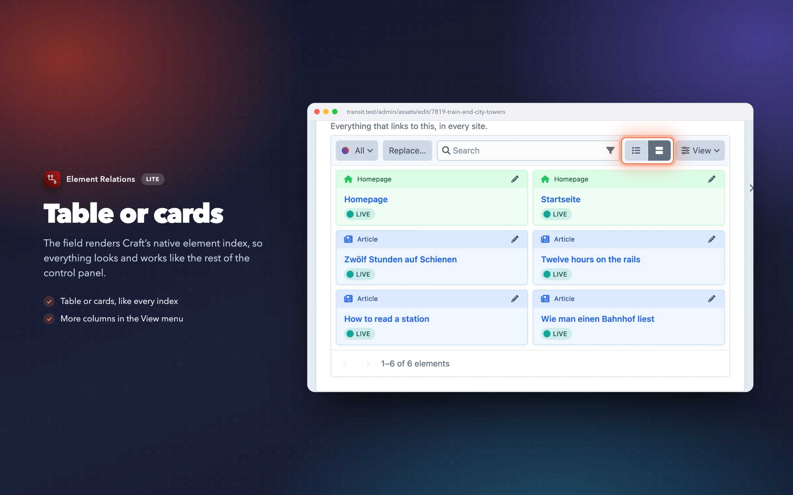

## On any element type

Add the field to the field layouts of entries, assets, categories, tags, users, products or global sets, for example on its own tab.

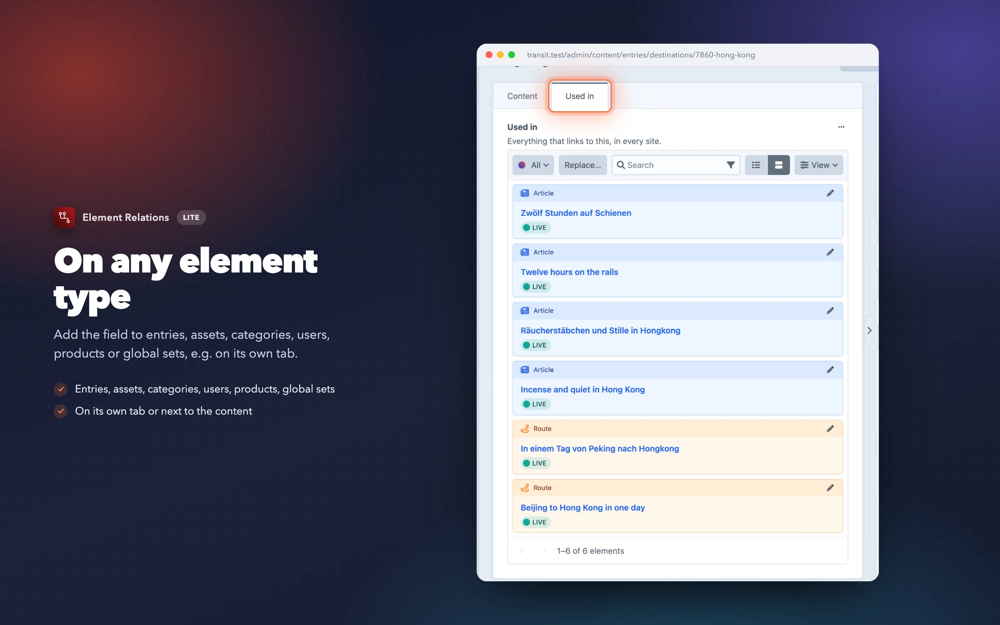

## Right in the element index

As an index column, the field shows the first usages and the total, and the index can be sorted by the number of usages.

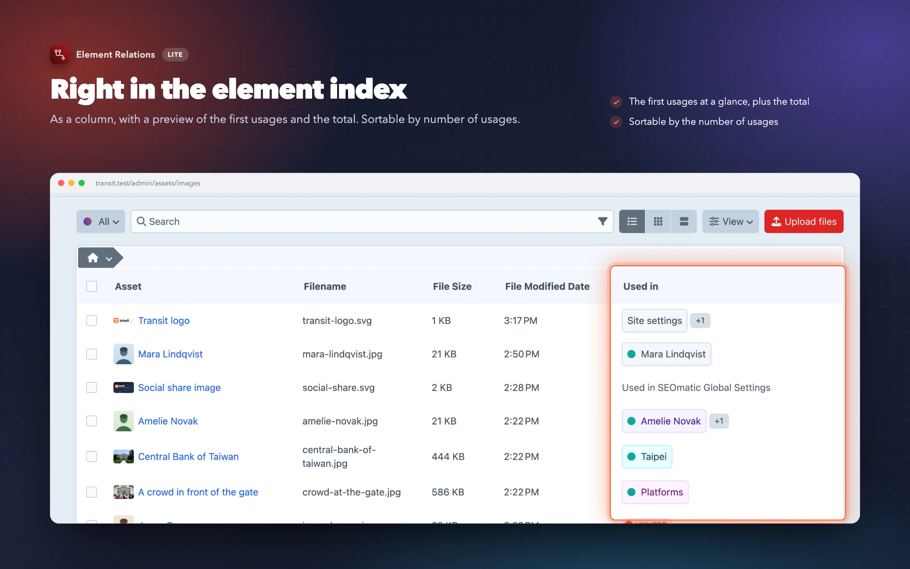

## Plugin settings count, too

Usages that are not elements, such as SEOmatic's global SEO image, appear below the list, linking to their settings page.

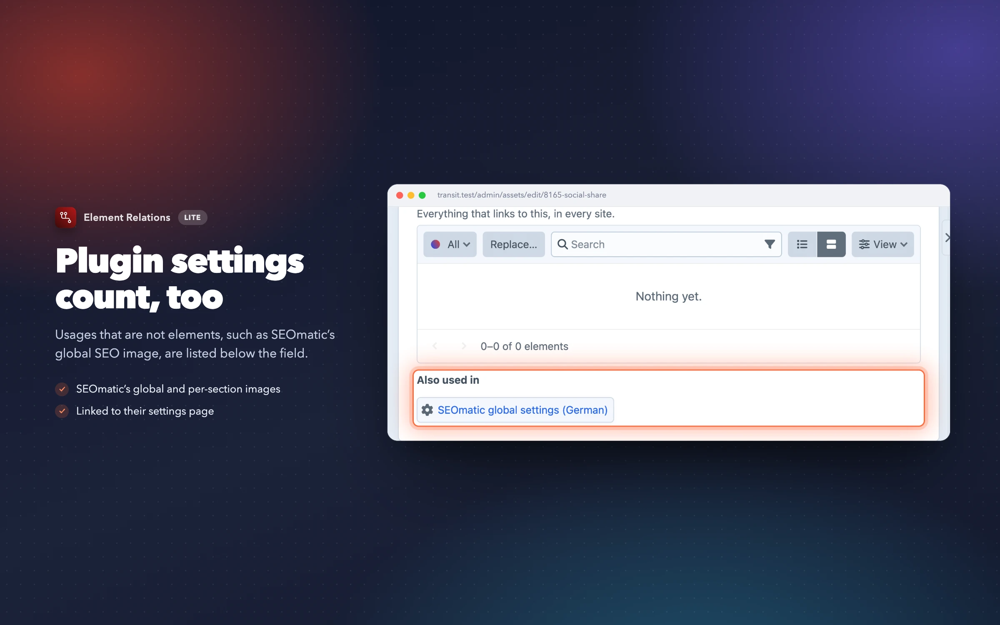

## Find what nobody uses Pro

A “Used anywhere” rule in Craft's filter, on top of any source and with Craft's bulk actions. Set it to off for everything nobody links to; plugin settings count as a usage. The same rule works in custom sources, for a fixed “Unused” entry in the sidebar.

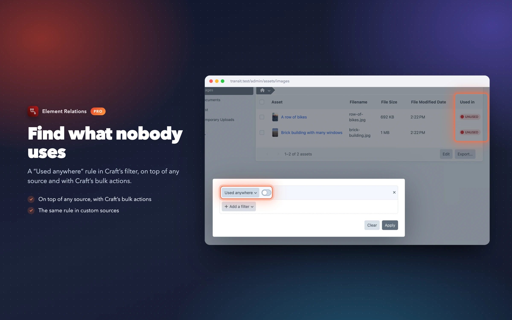

## Replace an element everywhere Pro

The field's **Replace…** button opens a slideout: pick the replacement with Craft's element picker, untick the usages that should keep the element (or choose “Everywhere” for elements with many usages), review, replace. Every supported field and plugin is rewritten the way it was read; only elements the user may save, and fields they may edit, are touched.

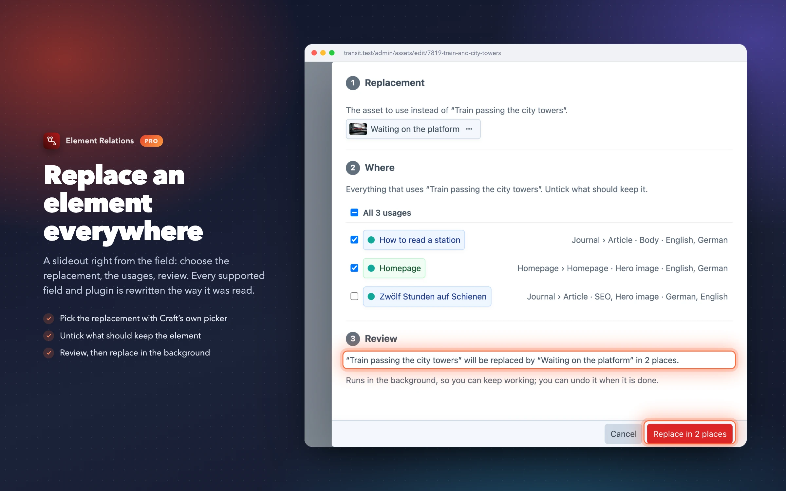

## Runs in the background Pro

Replacements and rollbacks run as queue jobs, in batches, as the user who started them, so saving many or large entries never blocks the page. The notice follows the job and shows its progress.

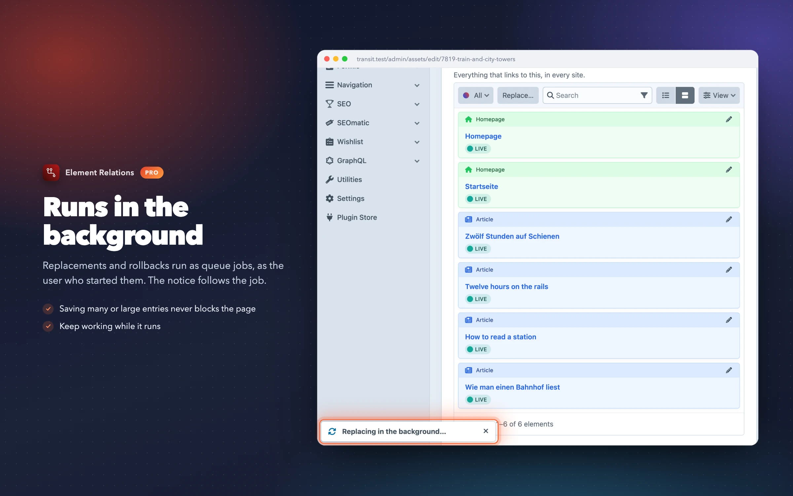

## Undo in one click Pro

When the job is done, the list refreshes and the notice offers Undo. Entries get a revision with a note for every step.

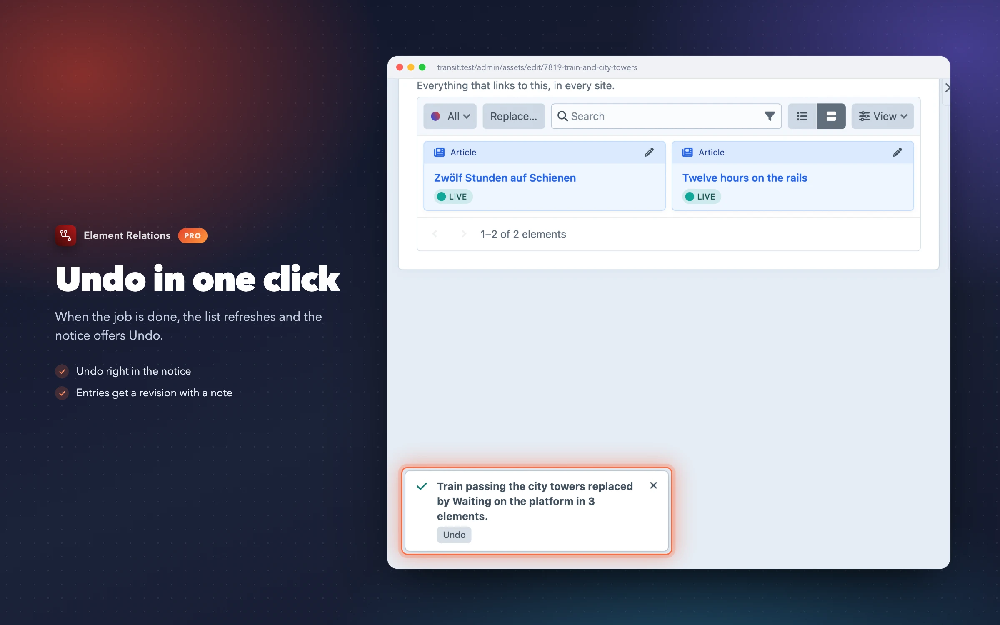

## History, rollback and revisions Pro

Utilities → Element Relations lists every replacement. **Roll back** swaps the reference back and keeps changes made since; **Revert to revisions** returns entries to their revision from before the replacement.

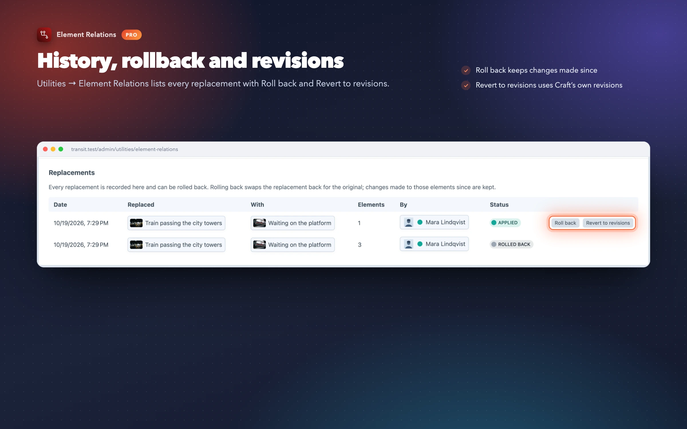

## Permissions Pro

Replacing and rolling back are permissions of their own. Everything else follows Craft's view and save permissions: users only see usages they may view.

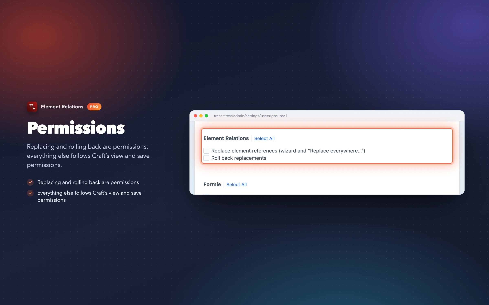

## Command line Pro

For deploy scripts and content migrations: `php craft element-relations/replace <from> <to>` (with `--usages`, `--site`, `--dry-run`), `replace/map mapping.csv` for many pairs at once, `replace/history` and `replace/rollback`. See the [README](../README.md#command-line-pro).

## Settings

Field settings like Craft's relation fields (view mode, status menu, page size), and plugin settings that can be overridden per environment in `config/element-relations.php`.

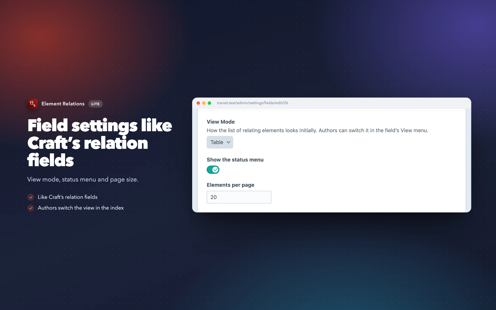

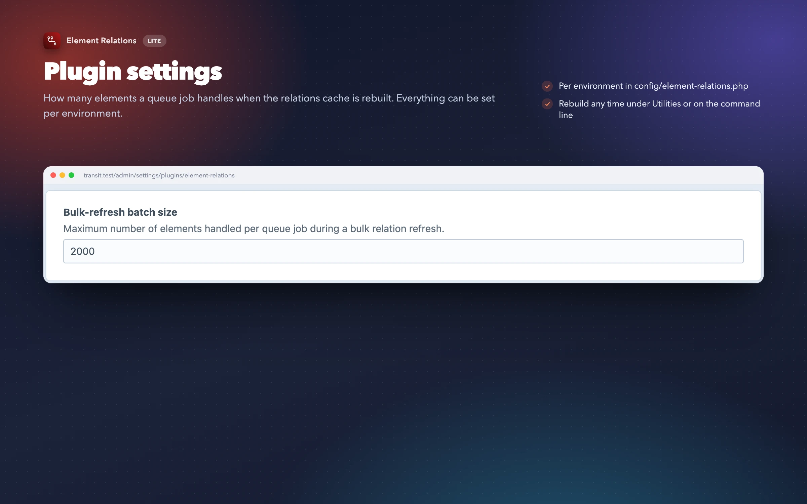
