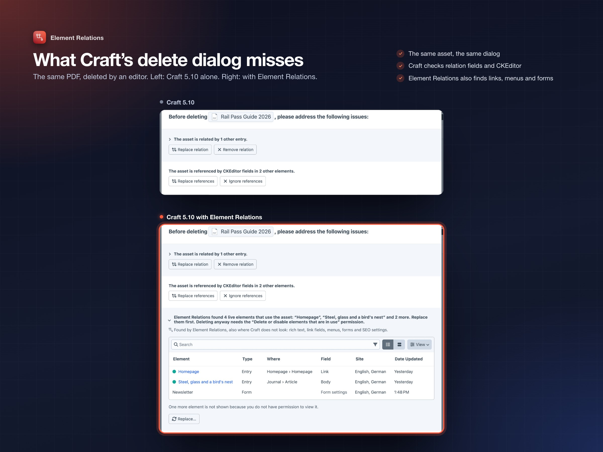
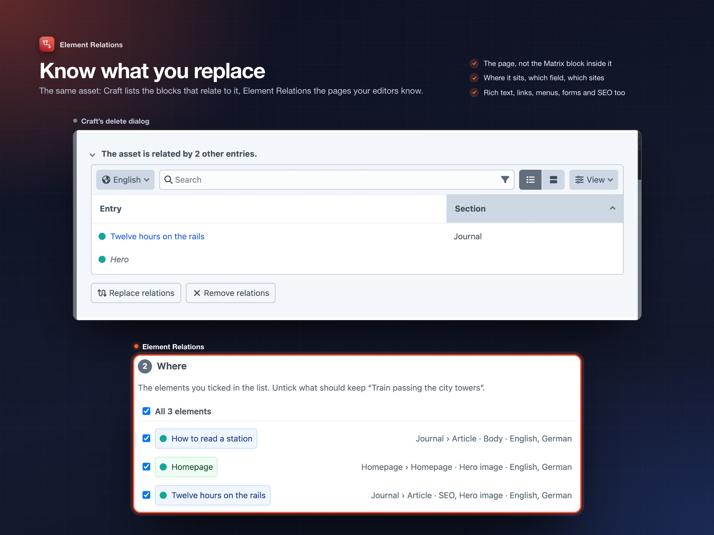

# Element Relations: a tour

Every feature, shown in the demo site “Transit”, a made-up travel journal (the photos are the author's own: [Frederic Köberl on Unsplash](https://unsplash.com/@internetztube)). Each picture shows the whole control panel page. Where the page shows the feature small, an inset zooms in. The demo is part of the dev environment: `dev/dev.sh` builds it, `dev/dev.sh screenshots` retakes every picture on this page.

## See where every element is used

The **Element Relations** field lists everything that links to the element it sits on: entries, Matrix and other nested content, products, Navigation menus, Formie forms, global sets, users, in every site. It lists what uses the element in the site you are editing (its version there); below the list, the other sites whose version is used, each with a link. Each row says where it lives and through which field.

## Filter by element type

When several element types use an element, a dropdown shows a count per type. It sits next to Craft's own search, sorting, status menu and pagination. Sorting and the filter offer Craft's own options and rules for the types in the list: Section, Entry Type, Post Date, Author, Filename, File Type, Group, …

## Table or cards

The field is Craft's own element index. It looks and works like the rest of the control panel, with card view and the extra columns of the View menu.

## On any element type

Add the field to the field layouts of entries, assets, categories, tags, users, products or global sets, for example on its own tab.

## Right in the element index

As an index column, the field shows the first usages and the total. The index can be sorted by the number of usages.

## Plugin settings count too

Usages that are not elements, like SEOmatic's global SEO image, appear below the list, with a link to their settings page.

## Find what nobody uses

A “Used anywhere” rule in Craft's filter. It works on any source, with Craft's bulk actions. Set it to off to see everything nobody links to. Plugin settings count as a usage. The same rule works in custom sources, for a fixed “Unused” entry in the sidebar.

## Replace it where you choose

Tick the usages in the field's list, like in any element index, and choose **Replace…** in its action bar. Narrow the list first with search, the type dropdown or the filter. Craft ticks within one page; the wizard then offers all usages in the list, on every page. **Replace everywhere…** on an element index takes all usages of an element.

## Review, then replace

A slideout with the replacement (Craft's element picker), the usages (untick what should keep the element) and a summary of what will change. Every supported field and plugin is rewritten the same way it was read. Only elements the user may save, and fields they may edit, are touched.

## Runs in the background

Replacements and rollbacks run as queue jobs, in batches, as the user who started them. So saving many or large entries never blocks the page. The notice follows the job and shows its progress.

## Undo in one click

When the job is done, the list refreshes and the notice offers Undo. Entries get a revision with a note for every step.

## History, rollback and revisions

Utilities → Element Relations lists every replacement. **Roll back** swaps the link back and keeps changes made since. **Revert to revisions** puts entries back to their revision from before the replacement.

## Keep what is in use

Editors can't delete what live content uses, or take it offline. Deleting (also for one site), disabling (also for one site), an expiry date in the past or a post date in the future are refused, on the edit page and in the index actions. The error says where the element is used. Only live usages count: a draft or a disabled entry that points to it does not block. The permission “Delete or disable elements that are in use” lets a user through. Console commands, migrations and queue jobs are never blocked.

On Craft 5.10 and later, this starts in Craft's own delete dialog. The live usages are listed as an issue to address, with **Replace…** (the replace wizard for all of them) and, only for users with the permission, **Delete anyway**.

The same PDF, deleted by an editor, once with Craft's own checks and once with Element Relations. Craft finds one relation and the CKEditor links. Element Relations also finds the homepage's Link field, the Newsletter form and a menu. The editor may not view that menu, so it is counted but not named.

## Know what you replace

Craft's own delete dialog lists the Matrix blocks that link to an element. It leaves out rich text, links, menus and forms. Element Relations lists the pages your editors know, with the field that holds the link and the sites, before anything is replaced.

## Permissions

Replacing, rolling back, and deleting or disabling elements that are in use are permissions of their own. Everything else follows Craft's view and save permissions: users only see usages they may view.

## Command line

For deploy scripts and content migrations: `php artisan element-relations:replace <from> <to>` (with `--usages`, `--site`, `--dry-run`), `replace:map mapping.csv` for many pairs at once, `replace:history` and `replace:rollback`. See the [README](../README.md#command-line).

## Settings

Field settings like Craft's relation fields (view mode, status menu, page size), and plugin settings that can be set per environment in `config/craft/element-relations.php`.

